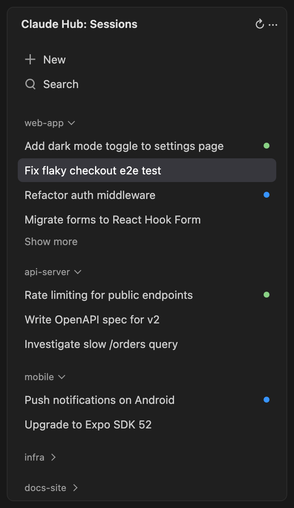

# Claude Hub

> **Unofficial.** Not affiliated with or endorsed by Anthropic. Claude and Claude Code are trademarks of Anthropic.

**Every Claude Code session from every project, in one sidebar.** The Claude Code extension shows only the sessions of the folder you have open. Claude Hub shows all of them, grouped by project, and opens any session in the right folder with one click, from any window.

## Features

- **Multi-project sessions**: all projects and their sessions in one list. A repository and its worktrees form one project.
- **Open from anywhere**: a session of another project opens its folder in a new window and resumes there.
- **Search** by title and by session content.
- **Live status**: green dot means Claude is working, blue means a reply you have not seen yet. Right-click a session → **Mark as unread**.
- **History viewer**: read any session without resuming it.
- **Open in** the Claude Code sidebar (default), an editor tab, or a terminal: **…** menu → **Open Sessions in**.

## Requirements

The [Claude Code](https://marketplace.visualstudio.com/items?itemName=anthropic.claude-code) extension, or the `claude` CLI for terminal mode. `git` on PATH.

## Privacy

Read-only access to `~/.claude`. No network requests, no telemetry.

## Limitations

- Uses internal Claude Code formats and commands, so a Claude Code update can break parts of it.
- Shows local sessions only (not Remote SSH, WSL or Dev Containers).

## License

[MIT](LICENSE)
